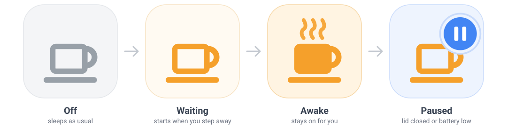

<p align="center">
  
</p>

<h1 align="center">Perk</h1>

<p align="center">
  <b>Keep your computer awake. Never your laptop in a bag.</b><br>
  A tiny, friendly keep-awake app for Windows and Linux.
</p>

---

Long download? Presentation? Reading a long document? Perk keeps your screen on and stops
your computer from dozing off, for as long as you need, with one click from the
system tray.

And when you close the lid, Perk steps aside straight away, so your laptop sleeps
like it normally would. No hot bags, no flat batteries.

## Why you'll like it

- ☕ **One click.** Click the cup in your tray to stay awake. Click again to stop.
- ⏱️ **Your timing.** Stay awake indefinitely, or for 30 minutes, 1 hour, 2 hours, or any time you like.
- 🚶 **Starts when you step away.** Optionally, the timer only counts while you're away, and Perk steps in just before your computer would fall asleep.
- 💼 **Bag-safe.** Closing the lid always lets your laptop sleep. Open it again and Perk picks up where it left off.
- 🔋 **Battery-aware.** If your battery runs low, Perk pauses itself until you plug in.
- 🪶 **Featherlight.** One small app, no background services, close to zero CPU.

## Get started

**Windows:** download and run `perk-<version>-windows-x86_64-setup.exe`. No admin rights needed.

**Linux (Ubuntu / Debian):** install the `.deb` package:

```sh
sudo apt install ./perk_*_amd64.deb
```

**Linux (Fedora / openSUSE):** install the `.rpm` package:

```sh
sudo dnf install ./perk-*.x86_64.rpm      # Fedora
sudo zypper install ./perk-*.x86_64.rpm   # openSUSE
```

Then look for the cup in your system tray.

## The cup tells you everything

<p align="center">
  
</p>

| Icon | Meaning |
|---|---|
| Grey cup | Off: your computer sleeps as usual |
| Amber outline cup | Waiting: the timer starts when you step away |
| Amber cup with steam | Keeping your computer awake |
| Cup with a blue pause badge | Paused for now (lid closed or battery low) |

Hover over the cup to see how much time is left. Right-click it for timers and settings.

### Start the timer when you step away

Turn on **Keep awake for → Start timer when I step away**. Then pick a time, say 30 minutes.

- While you're using the computer, Perk does nothing. Your normal sleep setting applies.
- Once you stop, the 30 minutes start counting. Perk checks your sleep setting (for example
  *sleep after 10 minutes*) and steps in one minute before that, at 9 minutes.
- Come back and the timer starts over next time you leave.
- With **Keep display on**, Perk also steps in before the screen would turn off.

This works for the timed choices. **Indefinitely** always keeps awake right away.
On Linux it needs GNOME (as on Ubuntu).

Need everything off right now? Choose **Emergency stop** or press `Ctrl+Alt+Shift+K`.

## Questions

**Does Perk change my power settings?**
No. It politely asks your computer to stay awake while it's on, and stops asking when it's off.
Quit Perk and everything is exactly as before.

**What if Perk crashes?**
Your computer goes back to its normal sleep schedule on its own.

**Can I start it automatically?**
Yes: right-click the cup, then **Settings → Launch at startup**.

## For developers

Building, testing and the technical details are in the [developer guide](docs/DEVELOPMENT.md).

## License

MIT
